## Цель работы
Исследование свойств универсальных алгоритмов синтаксического анализа контекстно-свободных языков.
## Ход работы 
1. Часть 1. Необходимо с использованием системы JFLAP, построить LL(1)-
грамматику, описывающую заданный язык, или формально доказать
невозможность этого. Полученная грамматика не должна повторять SLR(1)-
грамматику, конструируемую в части 3. Ассоциативность операций на
усмотрение разработчика.
2. Часть 2. Предложить программную реализацию метода рекурсивного спуска
для распознавания строк заданного языка. Представить формальное
доказательство принадлежности к классу LL(1) грамматики, лежащей в основе
синтаксического анализа заданного языка. Во всех случаях язык должен
состоять из последовательностей выражений. В качестве разделителя может
выступать символ новой строки, точка с запятой или любой другой символ, не
задействованный в других лексемах. Ассоциативность операций на усмотрение
разработчика. Результатом работы синтаксического анализатора является
выдача сообщения «Accepted» или «Rejected».
4. Часть 3. Необходимо с использованием системы JFLAP, построить SLR(1)-
грамматику, описывающую заданный язык, или формально доказать
невозможность этого. Во всех случаях реализуется язык, состоящий из
последовательностей операторов присваивания. В качестве разделителя может
выступать символ новой строки, точка с запятой или любой другой символ, не
задействованный в прочих лексемах. В качестве L-значения оператора
присваивания выступает только имя переменной. В правой части оператора
присваивания указывается выражение, элементы которых оговариваются в
каждом варианте задания. Ассоциативность операций на усмотрение
разработчика. Полученная грамматика не должна повторять LL(1)-грамматику,
конструируемую в части 1.дистанционно.
## Вариант 7
### Часть 1
Язык оператора присваивания, в правой части которого задано
выражение. Элементами выражений являются даты двух любых форматов,
имена переменных из одного символа (от a до d), знаки операций и скобки для
изменения порядка вычисления подвыражений. Операции (в сторону
уменьшения приоритета): унарная, бинарные, присваивание.  
### Часть 2
Язык выражений, элементами которых являются даты двух любых
форматов, имена переменных из 1-2 символов, целочисленные константы в
десятичной системе счисления, знаки операций и скобки для изменения
порядка вычисления подвыражений. Операции (в сторону уменьшения
приоритета): унарная, бинарные, присваивание.
### Часть 3
Элементами выражения являются даты двух любых форматов,
целочисленные константы, имена переменных из одного символа (от a до d),
знаки операций и скобки для изменения порядка вычисления подвыражений.
Операции (в сторону уменьшения приоритета): унарная, бинарные,
присваивание.
# Часть 1
## LL(1) грамматика
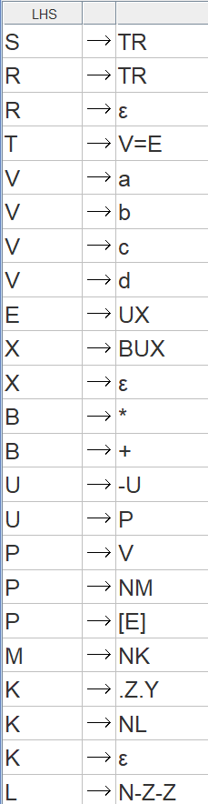  
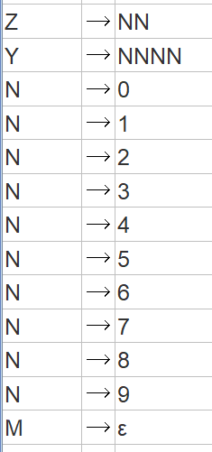
## Таблицы 
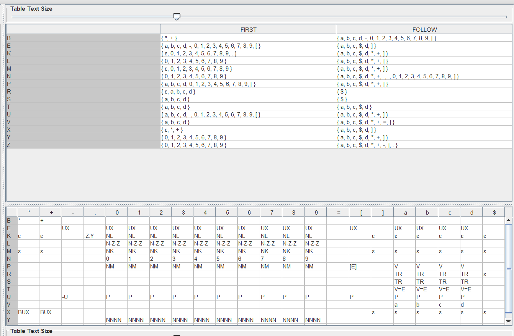
## Дерево для строки c=2025-12-31+12.05.2025
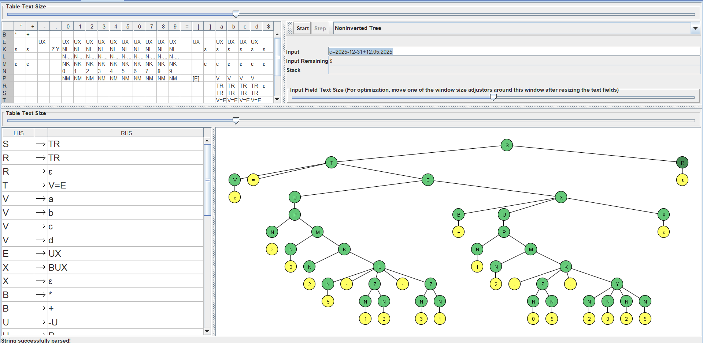
# Часть 2
## Правила грамматики
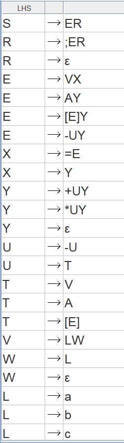  
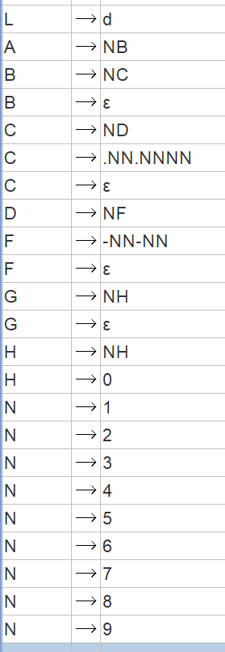
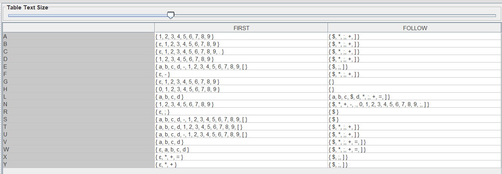
## Доказательство
Грамматика является LL(1), если для любых двух различных правил вида A -> α | β выполняются условия:

1. FIRST(α) ∩ FIRST(β) = ∅
2. Если α выводит ε, то FIRST(β) ∩ FOLLOW(A) = ∅

Проверка условий LL(1):

$E -> V X | A Y | [ E ] Y | - U Y:$    
FIRST(V X) = {a, b, c, d}, FIRST(A Y) = {0-9}, FIRST([ E ] Y) = {[}, FIRST(- U Y) = {-}. Все множества FIRST состоят из разных терминалов. Пересечений нет.

$X -> = E | Y:$   
 FIRST(= E) = {=}, FIRST(Y) = {+, *, ε}. Так как Y может выводить ε, проверяем пересечение: FIRST(= E) ∩ FOLLOW(X) = {=} ∩ {;, ], $} = ∅. Пересечений нет.

$Y -> + U Y | * U Y | ε:$   
 FIRST(+ U Y) = {+}, FIRST(* U Y) = {*}, FIRST(ε) = {ε}. При ε проверяем: FIRST(+ U Y) ∩ FOLLOW(Y) = {+} ∩ {;, ], } = ∅. Проверяем: FIRST(* U Y) ∩ FOLLOW(Y) = {*} ∩ {;, ], } = ∅. Пересечений нет.

$U -> - U | T:$   
 FIRST(- U) = {-}, FIRST(T) = {a, b, c, d, 0-9, [}. Пересечений нет.

$T -> V | A | [ E ]:$   
 FIRST(V) = {a, b, c, d}, FIRST(A) = {0-9}, FIRST([ E ]) = {[}. Все множества FIRST состоят из разных терминалов. Пересечений нет.

$R -> ; E R | ε:$   
 FIRST(; E R) = {;}, FIRST(ε) = {ε}. При ε проверяем: FIRST(; E R) ∩ FOLLOW(R) = {;} ∩ {$} = ∅. Пересечений нет.

$W -> L | ε:$   
 FIRST(L) = {a, b, c, d}, FIRST(ε) = {ε}. При ε проверяем: FIRST(L) ∩ FOLLOW(W) = {a, b, c, d} ∩ {=, +, *, ;, ], $} = ∅. Пересечений нет.

$B -> N C | ε:$   
 FIRST(N C) = {0-9}, FIRST(ε) = {ε}. При ε проверяем: FIRST(N C) ∩ FOLLOW(B) = {0-9} ∩ {+, *, ;, ], $} = ∅. Пересечений нет.

$C -> N D | . N N . N N N N | ε:$   
 FIRST(N D) = {0-9}, FIRST(. N N . N N N N) = {.}, FIRST(ε) = {ε}. При ε проверяем: FIRST(N D) ∩ FOLLOW(C) = {0-9} ∩ {+, *, ;, ], } = ∅. Проверяем: FIRST(. N N . N N N N) ∩ FOLLOW(C) = {.} ∩ {+, *, ;, ], } = ∅. Пересечений нет.

$F -> - N N - N N | ε:$   
 FIRST(- N N - N N) = {-}, FIRST(ε) = {ε}. При ε проверяем: FIRST(- N N - N N) ∩ FOLLOW(F) = {-} ∩ {+, *, ;, ], $} = ∅. Пересечений нет.

$L -> a | b | c | d:$   
 Все множества FIRST состоят из разных терминалов. Пересечений нет.

$N -> 0 | 1 | ... | 9:$   
 Все множества FIRST состоят из разных терминалов. Пересечений нет.

Вывод: Грамматика является строго LL(1), так как ни в одном правиле нет пересечений FIRST/FIRST и FIRST/FOLLOW.
## Программная реализация
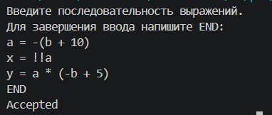  
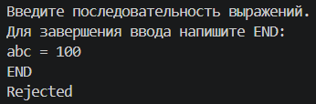  
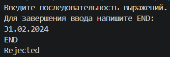  
# Часть 3
## SRL(1) грамматика
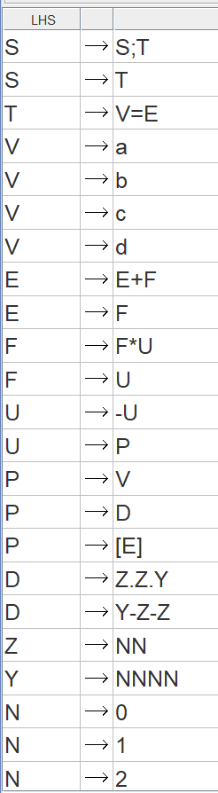  
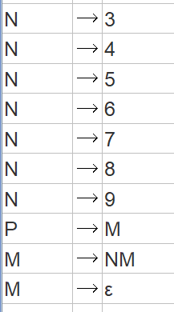  
## Таблицы
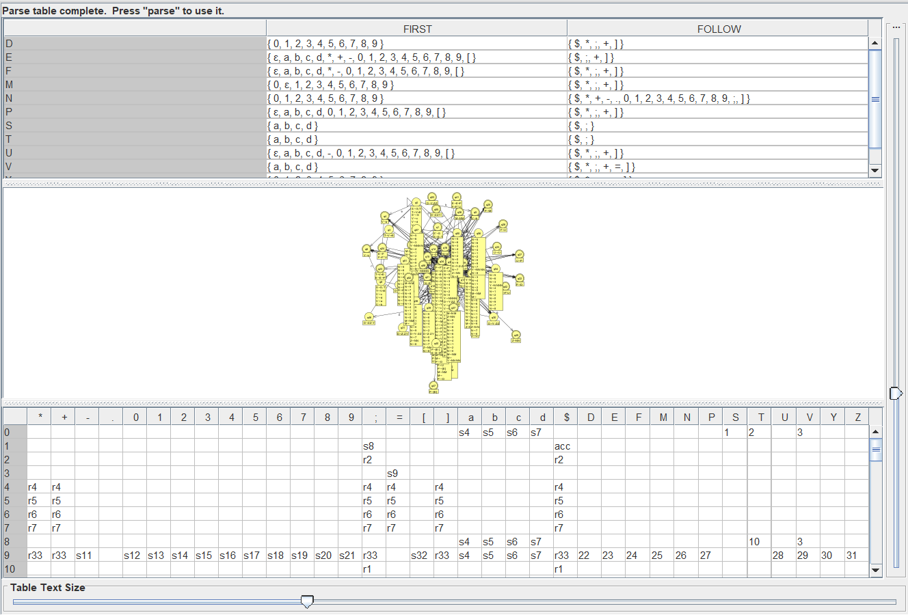
## Дерево для строки a=b;c=12.05.2025;d=2025-12-31;a=-b
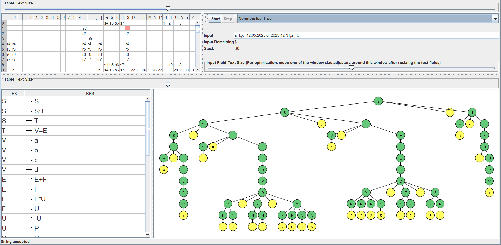